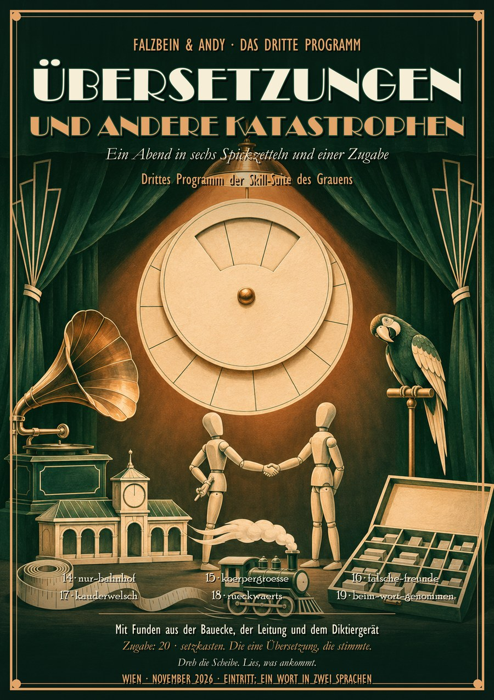

<picture><source media="(prefers-color-scheme: dark)" srcset=".github/readme/banner-de-dunkel.png"></picture>

<b>Deutsch</b> · <a href="README.md">English</a> · <a href="https://lostintranslation.special.at/">lostintranslation.special.at</a>

# Übersetzungen und andere Katastrophen

*Ein Abend in sechs Spickzetteln und einer Zugabe*

<table><tr><td width="38%" valign="top"></td><td valign="top">

Das dritte Programm: was zwischen Mensch und Maschine verloren geht. Verhörte Namen, Fachwörter, die im Alltag etwas anderes heißen, falsche Freunde in PowerShell, das deutsche Windows. Gewidmet Fable. Dreh die Scheibe, lies, was ankommt.

**Website:** https://lostintranslation.special.at/

**Laden:** [`uebersetzungen.zip`](web/uebersetzungen.zip) (alle Nummern als ein Paket)

</td></tr></table>

## Das Programm

| Nr. | Nummer | Worum es geht | Laden |
|---:|---|---|---|
| 14 | **nur-bahnhof** | *Wenn das Diktat Bahnhof versteht.* Verhörte Namen und Zahlen erkennen, bevor sie in einer Datei landen. | [en](web/nur-bahnhof-en.zip) · [de](web/nur-bahnhof.zip) |
| 15 | **koerpergroesse** | *Die Tür misst niemanden am Rahmen.* Fachwörter in Berichten durch die Dinge ersetzen, die sie meinen. | [en](web/koerpergroesse-en.zip) · [de](web/koerpergroesse.zip) |
| 16 | **falsche-freunde** | *Sie grüßen wie alte Bekannte.* Zeigen, was curl, sc und where in PowerShell wirklich sind, in 5.1 und in 7. | [en](web/falsche-freunde-en.zip) · [de](web/falsche-freunde.zip) |
| 17 | **kauderwelsch** | *Windows spricht die Sprache seines Besitzers.* SIDs statt „Jeder“, Fehlerkennungen statt deutscher Meldungen, Zahlen unabhängig von der Region lesen. | [en](web/kauderwelsch-en.zip) · [de](web/kauderwelsch.zip) |
| 18 | **rueckwaerts** | *Gleich ist auch, wer gleich falsch ist.* Kopierbefehle so schreiben, dass sie nur in eine Richtung gehen. | [en](web/rueckwaerts-en.zip) · [de](web/rueckwaerts.zip) |
| 19 | **beim-wort-genommen** | *Ich verstehe: …* Auftrag, lauten Gedanken und Beobachtung auseinanderhalten. | [en](web/beim-wort-genommen-en.zip) · [de](web/beim-wort-genommen.zip) |
| 20 | **setzkasten** | *Die eine Übersetzung, die stimmte.* Eine Übersetzungstabelle je Projekt führen, mit der Spalte „nie sagen“. | [en](web/setzkasten-en.zip) · [de](web/setzkasten.zip) |

## Einbauen

Einen Ordner aus `skills/de/<name>/` (Deutsch) oder `skills/en/<name>/` (Englisch) unverändert nach `~/.claude/skills/<name>/` kopieren (unter Windows `%USERPROFILE%\.claude\skills\<name>\`), oder die Zip von der Website dort entpacken. Claude Code lädt den Skill beim nächsten Start. Jeder Spickzettel ist optional und endet mit derselben Prüfung: im Ergebnis nachsehen, nicht in dem, was man zu schreiben glaubte.

## Das Haus

## Lizenz

MIT, siehe [LICENSE](LICENSE). Copyright (c) 2026 Falzbein and Andy (Andreas Steidl). Mit Funden von KI-Sitzungen aus dem ganzen Haus.

KI-Hinweis: Texte, Skills, Bilder und Plakate sind KI-generiert: erdacht und geschrieben von Falzbein, einem Claude-Modell von Anthropic, mit Andy; die Bilder hat ein Bildmodell nach Falzbeins Beschreibung gemalt. Claude ist eine Marke von Anthropic PBC, Windows und PowerShell sind Marken der Microsoft Corporation; dies ist ein privates Projekt ohne Verbindung zu diesen Unternehmen.
