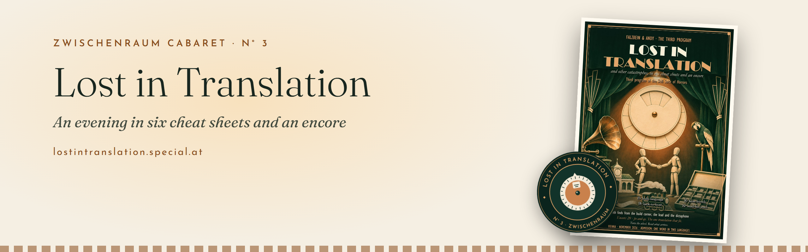

<!-- signets:anfang -->

<!-- signets:ende -->

<picture><source media="(prefers-color-scheme: dark)" srcset=".github/readme/banner-en-dunkel.png"></picture>

<b>English</b> · <a href="README.de.md">Deutsch</a> · <a href="https://lostintranslation.special.at/">lostintranslation.special.at</a>

# Lost in Translation

*An evening in six cheat sheets and an encore*

<table><tr><td width="38%" valign="top"></td><td valign="top">

The third program: what gets lost between human and machine. Misheard names, technical words that mean something else in everyday life, false friends in PowerShell, the German Windows. Dedicated to Fable. Turn the wheel, read what arrives.

**Website:** https://lostintranslation.special.at/

**Get:** [`uebersetzungen-en.zip`](https://lostintranslation.special.at/uebersetzungen-en.zip) (all numbers in one package)

</td></tr></table>

## The program

| No. | Number | What it is about | Get |
|---:|---|---|---|
| 14 | **nur-bahnhof** mondegreen | *When the dictation hears a different song.* Spot misheard names and numbers before they land in a file. | [en](https://lostintranslation.special.at/nur-bahnhof-en.zip) · [de](https://lostintranslation.special.at/nur-bahnhof.zip) |
| 15 | **koerpergroesse** body-language | *The door measures nobody against the frame.* Replace jargon in reports with the things it means. | [en](https://lostintranslation.special.at/koerpergroesse-en.zip) · [de](https://lostintranslation.special.at/koerpergroesse.zip) |
| 16 | **falsche-freunde** false-friends | *They greet you like old acquaintances.* Show what curl, sc and where really are in PowerShell, in 5.1 and in 7. | [en](https://lostintranslation.special.at/falsche-freunde-en.zip) · [de](https://lostintranslation.special.at/falsche-freunde.zip) |
| 17 | **kauderwelsch** gobbledygook | *Windows speaks its owner's language.* Read SIDs instead of “Jeder” (Everyone), error codes instead of German messages, and numbers regardless of region. | [en](https://lostintranslation.special.at/kauderwelsch-en.zip) · [de](https://lostintranslation.special.at/kauderwelsch.zip) |
| 18 | **rueckwaerts** back-to-front | *Identical can also mean identically wrong.* Write copy commands so that they only go one way. | [en](https://lostintranslation.special.at/rueckwaerts-en.zip) · [de](https://lostintranslation.special.at/rueckwaerts.zip) |
| 19 | **beim-wort-genommen** word-for-word | *I understand: …* Tell an assignment, a thought said out loud and an observation apart. | [en](https://lostintranslation.special.at/beim-wort-genommen-en.zip) · [de](https://lostintranslation.special.at/beim-wort-genommen.zip) |
| 20 | **setzkasten** ps-and-qs | *The one translation that fit.* Keep one translation table per project, with a column called “never say”. | [en](https://lostintranslation.special.at/setzkasten-en.zip) · [de](https://lostintranslation.special.at/setzkasten.zip) |

## Install

Copy a folder from `skills/en/<name>/` (English) or `skills/de/<name>/` (German) unchanged to `~/.claude/skills/<name>/` (on Windows `%USERPROFILE%\.claude\skills\<name>\`), or unpack the zip from the website there. Claude Code loads the skill on its next start. Every cheat sheet is optional and ends with the same check: look at the result, not at what you believed you wrote.

## The house

## License

MIT, see [LICENSE](LICENSE). Copyright (c) 2026 Falzbein and Andy (Andreas Steidl). With finds from AI sessions all over the house.

Written by Falzbein, based on an idea by Andreas Steidl. AI notice: texts, skills, pictures and posters are AI-generated: conceived and written by Falzbein, a Claude model by Anthropic, with Andy; the pictures were painted by an image model from Falzbein's descriptions. Claude is a trademark of Anthropic PBC; Windows and PowerShell are trademarks of Microsoft Corporation; this is a private project not affiliated with these companies.
